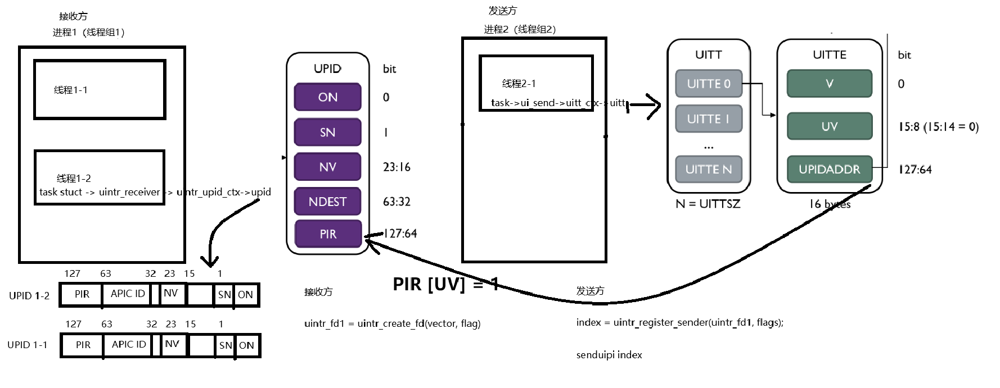
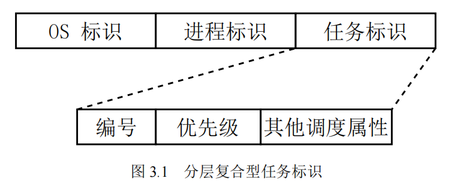
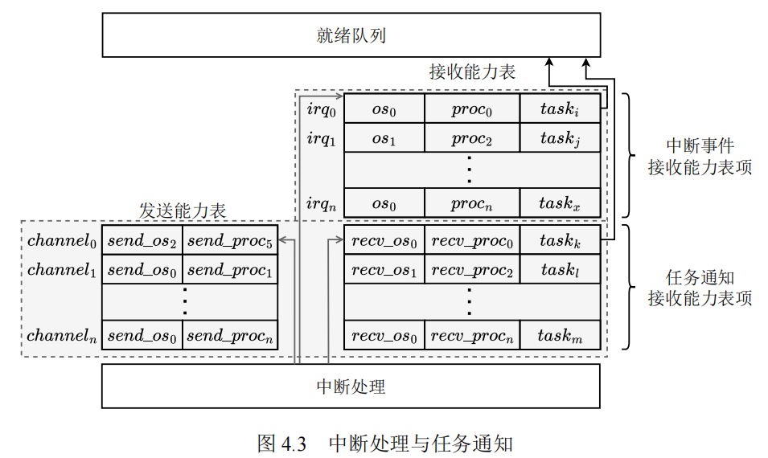

# 用户态中断接收方如何区分多发送方

目的：为了能让接收方区分不同的发送方，发送方也能精准传递中断给接收方，并且收发双方最好是协程粒度。

可行性分析：

（1）X86的用户态中断是如何支持接收方判断不同的发送方的

每个接收方线程有自己的独立用户态中断向量空间（每个线程有64个用户态中断号 0-63），当发送方线程注册时，指定一个接收方向量空间的中断号（这个中断号当然是程序员为收发双方规定好的）。发送方执行 senduipi 指令的时候，接收方会收到对应中断号的用户态中断，然后根据中断号判断不同的发送方线程。

（2）X86的用户态中断上下文可以携带哪些信息，如何传递。

用户态中断上下文唯一携带的信息是发送方注册的中断向量号（unsigned long long vector 64位，但是前面也说了向量空间只有64个，所以只用到低6 位）。

vector 高58位能用吗？不能，因为这是硬件自动读取内存中 UPID.PIR (更准确是先读到 UIRR 寄存器)，然后判断 PIR 最低位为1的下标，自动压入栈中，作为用户态中断处理程序的第二个参数vector。

如果有多个发送方同时发送，先处理谁？多个发送方同时发送，那么PIR中有多个置位，按照低位优先的顺序，先处理最低位的用户态中断，即把最低位下标 推入栈中，跳转到用户态中断处理程序，处理完后，退出用户态中断处理程序，在把下一个用户态中断下标推入栈中，重新处理下一个用户态中断。

结论：接收方能够区分不同的发送方，但是只限于线程级别的区分，使用中断号区分不同的线程，而且必须提前约定好才能避免发送方冲突，最多区分64个发送方。

内核向用户态线程发送用户态中断，是通过直接写PIR的方式触发用户态中断，因此也可以由内核和用户态线程约定不同的向量号代表什么样的中断源（比如是信号，网络，串口等）。

# 用户态中断发送方如何区分多接收方

发送方只要能够知道接收方的UPID的地址，并且能够置 UPID.PIR 为1就能够发送用户态中断。

对于用户态程序而言，依赖的是UITT表获取UPID地址。

senduipi index 参数为UITTE的下标，该指令到UITTE中找到对应接收方的 UPID 地址，然后置 UPID.PIR[UV] = 1。

UITTE如何创建？依赖uintr_register_sender(uintr_fd, flag)系统调用创建。
uintr_fd 参数是接收方创建（通过intr_create_fd(vector, flag)），然后传递给接收方的（可以通过父子进程传递，socket发送等方式）。

对于内核而言，可以通过 PID 找到接收方的 Task struct。UPID地址为 task_struct->uintr_receiver->uintr_upid_ctx->upid。

# TAIC的做法参考

接收能力表中的用于记录与中断处理相关的能力。在使用时，软件通过 register 接口向 TAIC 中写中断号 𝑖𝑟𝑞𝑖、接收中断的任务的操作系统标识 𝑜𝑠𝑗、进程标识 𝑝𝑟𝑜𝑐𝑘 以及任务标识 𝑡𝑎𝑠𝑘𝑙，TAIC 将任务标识写入到中断号 𝑖𝑟𝑞𝑖 对应的表项中，注册成功即使能了硬件处理外部中断机制。
当外部设备产生中断信号时，TAIC 的中断处理模块会根据中断号来检查对应的表项，若其中存在任务标识，将任务标识从表项中取出，并放入就绪队列中的合适位置，以此来唤醒因为等待外部设备中断而进入阻塞状态的任务。

接收能力表中表项用于记录与任务通知相关的能力，记录了接收方任务的操作系统标识 𝑟𝑒𝑐𝑣_𝑜𝑠𝑖、进程标识𝑟𝑒𝑐𝑣_𝑝𝑟𝑜𝑐𝑗 和任务标识 𝑡𝑎𝑠𝑘𝑘。发送能力表则只记录与任务通知相关的接收方的操作系统标识 𝑠𝑒𝑛𝑑_𝑜𝑠𝑖、进程标识 𝑠𝑒𝑛𝑑_𝑝𝑟𝑜𝑐𝑗。

发送能力表项和接收能力表项由通道号 𝑐ℎ𝑎𝑛𝑛𝑒𝑙𝑖 连接，构成了（sender，receiver）二元组，这表示了一条可以跨越不同地址空间、不同特权级的任务通知的通道。发送方任务成功发送通知后，TAIC 将接收能力表中记录的任务标识插入到就绪队列中，唤醒任务。

发送用户态中断：当 CPU 正在运行用户态任务，且被唤醒的任务与正在运行的任务处于同一个地址空间且都运行在用户态时，TAIC 需要直接发送用户态中断，让 CPU 能够直接在用户态进行响应，完成任务切换，减少特权级切换的开
销。论文在 rocket-chip 软核[89] 上实现了与用户态中断相关的控制寄存器（uepc、ustatus、ucause、utvec 等）以及 uret 指令。TAIC 在内部维护了一个 usip 寄存器并与 CPU 的 mip 寄存器的 USIP 位相连，实现了 RISC-V 的 N 扩展。当需要发送用户态中断时，TAIC 只需将 ssip 寄存器置为 1，USIP 位将被拉高，CPU 跳转至用户
态的中断向量寄存器 utvec 指向的位置，保存被打断任务的寄存器现场，从 TAIC中取出被唤醒的任务标识并执行任务。